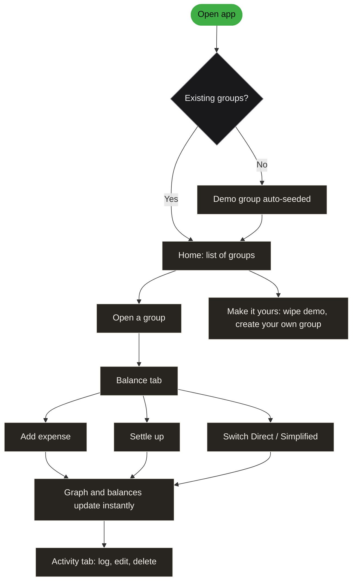

<div align="center">


<br/>

[](https://splid.unfo.workers.dev/)

<br/>


▀▄▀▄▀▄▀▄▀▄▀▄▀▄▀▄▀▄▀▄▀▄▀▄▀▄▀▄

</div>

<div align="center"></div>

<p align="center">
<b>Hisaab</b> (<i>हिसाब</i>, "the accounts") is a lightweight expense splitter for groups: trips, flatmates, dinners, anything shared.<br/>
Log an expense, pick a split, and a live balance graph shows exactly who owes whom.
</p>

```
╔═[ HISAAB ]════════════════════════════════╗
║  GENRE   : Expense splitter               ║
║  SPLITS  : Equal / custom / percent       ║
║  GRAPH   : Live SVG: direct + simplified  ║
║  BACKEND : None                           ║
║  BUILD   : None                           ║
║  STORAGE : localStorage (your browser)    ║
║  STACK   : React + htm + Tailwind         ║
╚═══════════════════════════════════════════╝
```

<br/>

<div align="center"></div>

- 👥 **Groups & members:** create any number of groups, add or remove people at any time
- ⚖️ **Flexible splits:** equal, custom amounts, or percentages, set per expense
- 🏷 **Categories:** food, travel, stay and misc, each with its own icon and color
- 🕸 **Live balance graph:** an animated SVG of who owes whom, in **Direct** (every real debt) and **Simplified** (fewest payments) views
- 🤝 **Settle up:** record full or partial payments; the graph and history update instantly
- 🧾 **Activity timeline:** a chronological log of every expense and settlement, editable and deletable
- 🧭 **Guided tour:** a coach-mark walkthrough on seeded demo data (the "Goa Trip" group)
- 🔒 **Zero backend:** everything lives in `localStorage`; nothing leaves the browser

<br/>

<div align="center"></div>

Every expense updates a pairwise ledger between members, and settlements subtract from it. From that ledger Hisaab derives three things: the **direct edges** (real person-to-person debts), each member's **net balance**, and the **simplified payments**, the fewest transfers that zero everyone out.

A tiny example (illustrative numbers):

```
DIRECT (2 payments)            SIMPLIFIED (1 payment)

  A --500--> B --500--> C        A ------500------> C

  net balance:  A -500   B 0   C +500
```

The simplified view uses a greedy pass: sort debtors and creditors by amount, match the largest debtor with the largest creditor, repeat.

| Concept | Meaning |
| --- | --- |
| **Group** | Members, expenses and settlements together (e.g. "Goa Trip") |
| **Expense** | An amount, a payer, a category and a split across members |
| **Split** | `equal`, `custom` or `pct` (percentage) |
| **Settlement** | A recorded payment between two members, full or partial |
| **Net balance** | What a member is owed (+) or owes (−) across the group |

<br/>

<h3 align="center">░▒▓ &nbsp;FLOW&nbsp; ▓▒░</h3>



<br/>

<div align="center"></div>

Clone or download the project, then open `index.html` in a browser, or serve the folder with any static file server:

```bash
# Option 1: just open it
open index.html

# Option 2: serve it locally
npx serve .
```

That's it. On first load the app seeds a demo group ("Goa Trip") so there's something to explore right away.

```
.
├── index.html   # entry point: CDN script tags, Tailwind config and the app shell
├── app.js       # components, state, money math, demo data
├── styles.css   # form primitives, keyframe animations, range-input styling
├── logo_s.svg   # logo
├── pixel-hero.gif / pixel-footer.gif   # README banner GIFs
└── h-*.png      # README section headers
```

<br/>

<h3 align="center">░▒▓ &nbsp;MAKE IT YOURS&nbsp; ▓▒░</h3>

- 🎨 **Colors & fonts:** edit the `tailwind.config` block in `index.html`
- 🏷 **Categories:** add or edit entries in the `CATS` object in `app.js`
- 🧑 **Avatar palette:** the `AV` array in `app.js` controls member colors
- 🧭 **Tour copy:** edit `TOUR_STEPS` in `app.js` to change the onboarding text

<br/>

<div align="center"></div>

> Hisaab stores everything under a single `localStorage` key, `hisaab.v2`. There is no server, no account and no network request involving your data. Clearing the browser's storage for the page resets the app to the seeded demo.

<br/>

<div align="center">

▀▄▀▄▀▄▀▄▀▄▀▄▀▄▀▄▀▄▀▄▀▄▀▄▀▄▀▄


Built by [**@unfotable**](https://github.com/unfotable) &nbsp;·&nbsp; Also made: [**SYNCRO**](https://github.com/unfotable/syncro), notes, sheets and boards in one tab

</div>
